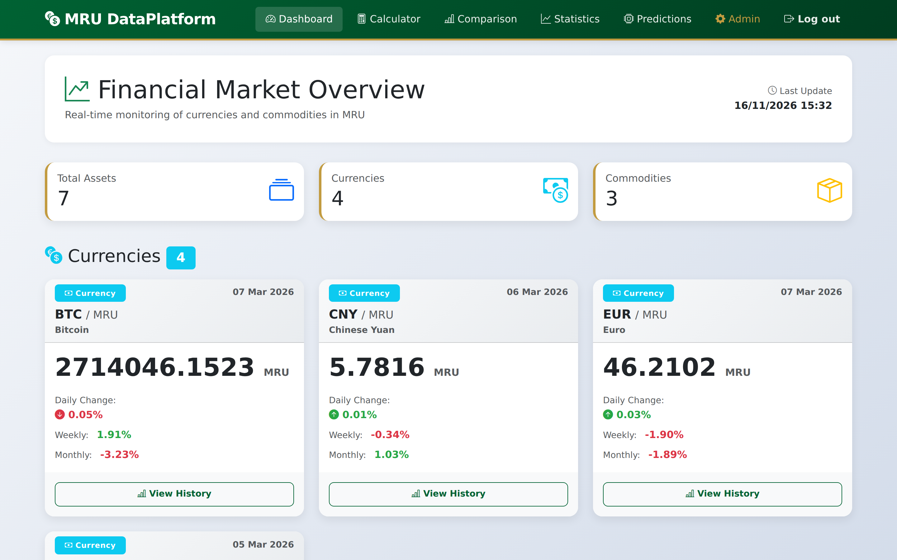
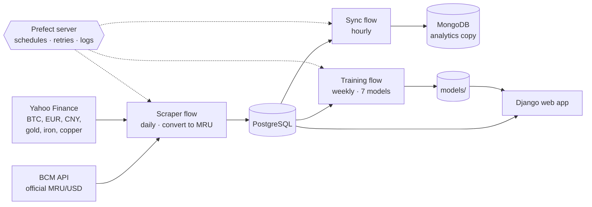
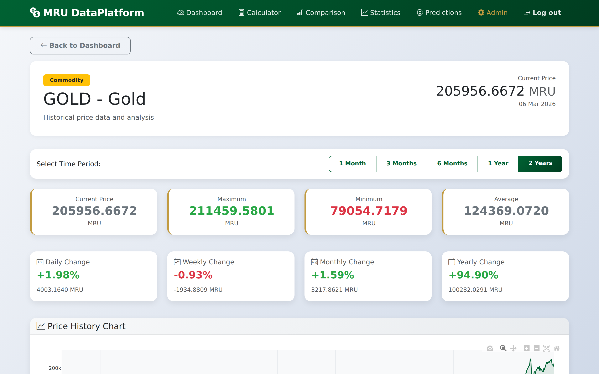
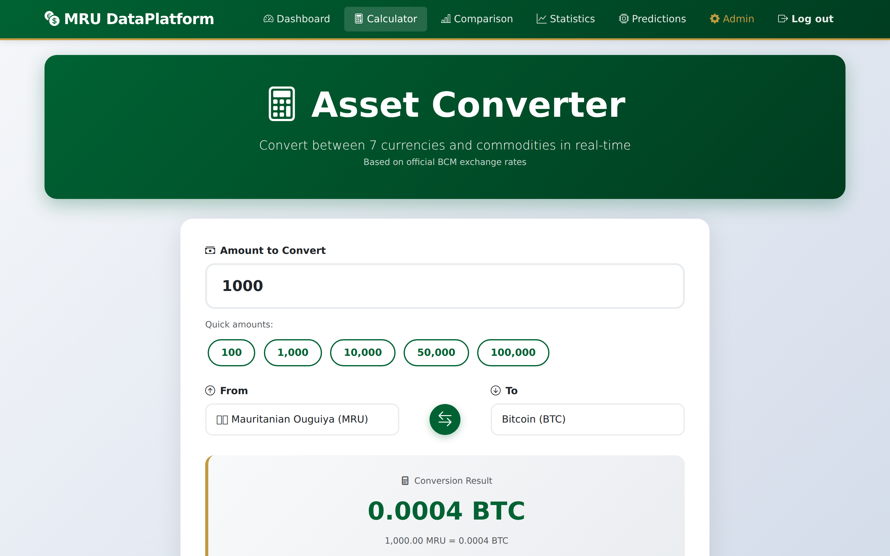
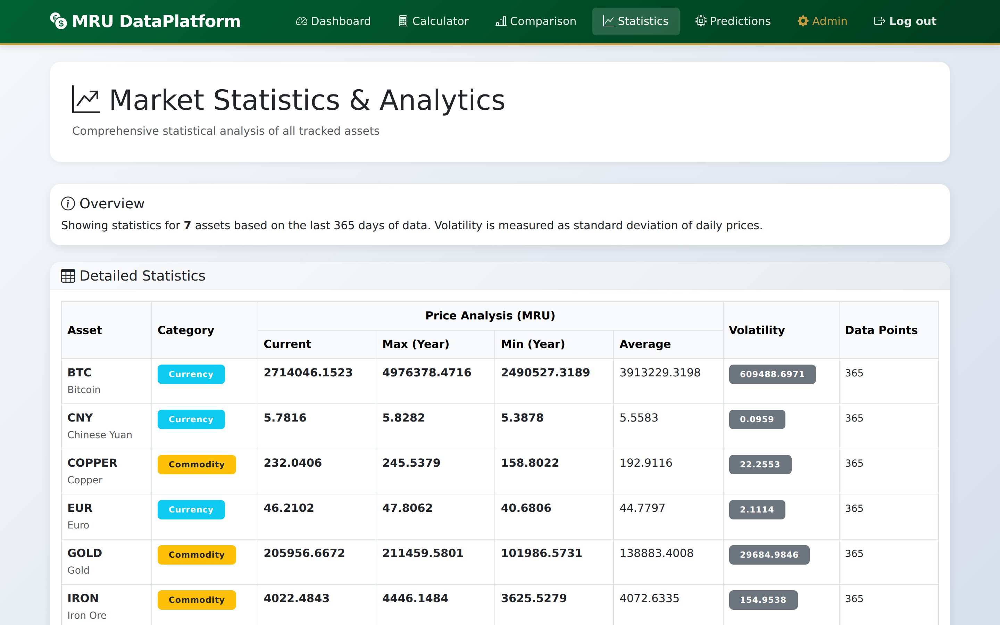
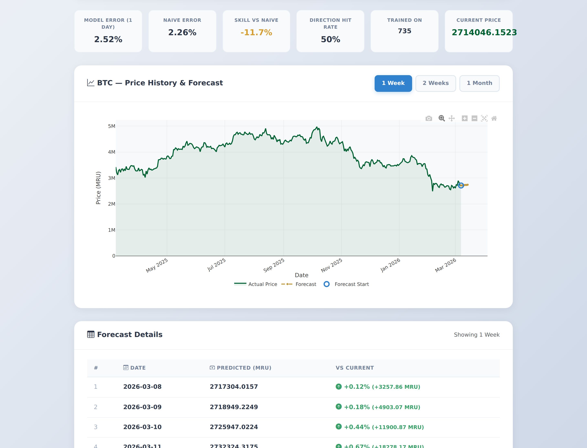
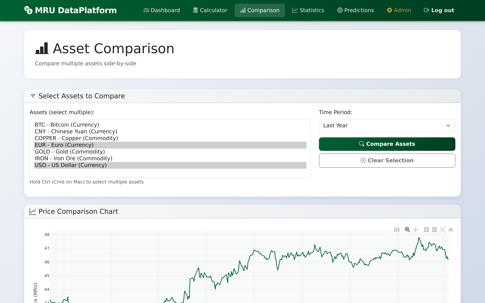
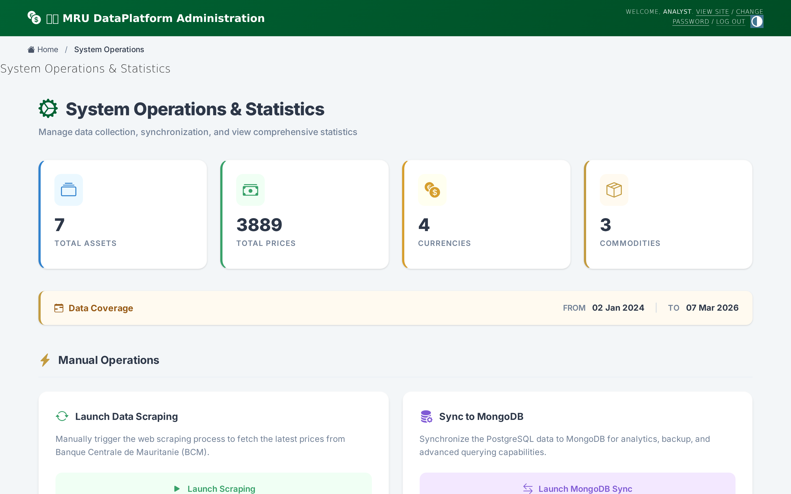
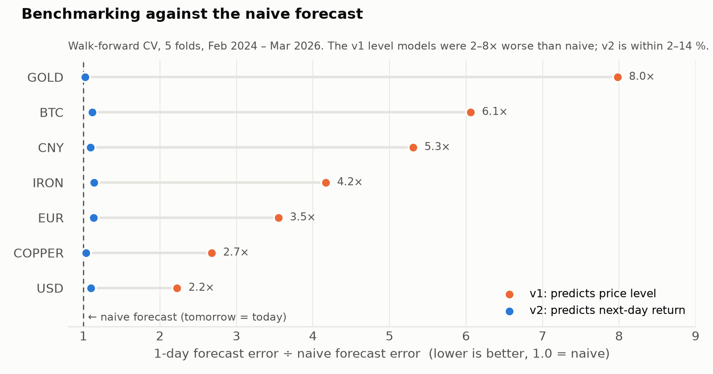

# MRU Data Platform

**A data platform that tracks currencies and commodities in Mauritanian ouguiya (MRU). It combines the Central Bank of Mauritania's official rates with market prices, runs orchestrated ETL and ML pipelines, and serves a Django analytics dashboard with price forecasts benchmarked against a naive baseline.**

Django · PostgreSQL · MongoDB · Prefect · scikit-learn · Plotly · Docker Compose



---

## The problem

Prices that matter in Mauritania (dollar and euro rates, gold, iron ore, copper) are published in different places, in different units and mostly in USD. Comparing them in **MRU** means daily manual conversions with the official BCM rate, there's no history in one place, and no quick way to ask how much gold 50,000 MRU buys today.

## What it does



- **Acquisition:** a daily Prefect flow pulls the official MRU/USD rate from the **Central Bank of Mauritania** (BCM) API and the market prices from Yahoo Finance, then stores everything in MRU in PostgreSQL. The conversion is one tested function:

  | Asset | Quote | MRU price |
  |---|---|---|
  | USD | BCM rate | as published |
  | EUR | EUR/USD | quote × MRU/USD |
  | CNY | CNY per USD | MRU/USD ÷ quote |
  | BTC, gold (oz), iron ore (t), copper (lb) | USD | quote × MRU/USD |

  On weekends and holidays the last published BCM rate is carried forward.
- **NoSQL copy:** an hourly flow mirrors prices into MongoDB as denormalised documents for analytics clients.
- **Forecasting:** a weekly flow trains one gradient-boosting model per asset and benchmarks it against the naive forecast (see [Results](#results)).
- **Web app** (login required):
  - a dashboard with daily, weekly and monthly change;
  - asset history with time ranges;
  - side-by-side comparison;
  - yearly statistics and volatility;
  - an MRU ⇄ asset converter;
  - forecasts for 1 week, 2 weeks and 1 month;
  - a custom admin with an operations page to trigger the scraper and the sync manually.

| Asset history | Converter | Statistics |
|---|---|---|
|  |  |  |

| Forecasts with naive benchmark | Comparison | Admin operations |
|---|---|---|
|  |  |  |

## Results

**Data:** 3,889 daily prices for 7 assets, **Feb 2024 – Mar 2026**: 441 official BCM rates plus Yahoo Finance quotes.

**Forecasting, measured honestly.** Every model is evaluated with 5-fold walk-forward cross-validation on 1-day-ahead prices and compared with the **naive forecast, "tomorrow = today"**. The naive forecast is notoriously hard to beat for market prices.



| Asset | Naive error | v1 (price level) | v2 (next-day return) | v2 skill vs naive | Direction hit rate |
|---|---|---|---|---|---|
| BTC | 2.26 % | 13.68 % | 2.52 % | −11.7 % | 50 % |
| Gold | 0.69 % | 5.50 % | 0.70 % | −2.1 % | 56 % |
| Copper | 1.13 % | 3.02 % | 1.17 % | −3.5 % | 55 % |
| Iron ore | 0.57 % | 2.36 % | 0.64 % | −13.8 % | 48 % |
| EUR | 0.37 % | 1.31 % | 0.42 % | −13.4 % | 48 % |
| CNY | 0.15 % | 0.80 % | 0.16 % | −9.1 % | 51 % |
| USD | 0.08 % | 0.17 % | 0.08 % | −10.1 % | 50 % |

*Errors are MAE as a percentage of the last price. Raw numbers: [`docs/figures/model_benchmark.csv`](docs/figures/model_benchmark.csv).*

- **v1 predicted price levels with tree ensembles**, which cannot extrapolate beyond the price range seen in training. It was **2.2–8× worse than the naive forecast**, which explains the negative R² values it used to display.
- **v2 predicts the next-day log-return** from 18 scale-free features: past returns, distance to moving averages, volatility and calendar effects. Every feature uses only data up to the previous day, and a test enforces it. v2 cuts the error **2–8× compared with v1**, landing within 2–14 % of naive.
- **No model beats "tomorrow = today"**, and the up/down hit rate stays close to a coin flip (48–56 %). That's the expected outcome for liquid market prices. The app therefore shows the naive error and the skill score next to every forecast, and labels forecasts as scenarios, not advice.

**Bugs found while preparing this release:**
- **CNY was stored as yuan per dollar** (≈ 7.0) instead of MRU per yuan (≈ 5.6), an error of about 24%. It's fixed, with a regression test.
- **The forecast table's "vs current" column showed the predicted price** instead of the change. It's fixed.

## Tech stack

- **Backend:** Django 5.2, Gunicorn, PostgreSQL 15 (SQLite fallback for local development)
- **Pipelines:** Prefect 3 (server, worker, cron deployments), requests, yfinance, pandas
- **NoSQL:** MongoDB 4.4 via pymongo
- **ML:** scikit-learn gradient boosting (Huber loss), walk-forward `TimeSeriesSplit`, joblib
- **Frontend:** Django templates, Bootstrap 5, Plotly
- **Ops:** Docker Compose. Only the web port is published; the databases and Prefect UI listen on 127.0.0.1.
- **Tests:** pytest-django, 28 tests (conversion rules, no-leakage features, naive benchmark, auth on every page, management commands)

## Project structure

```
mru-data-platform/
├── scraper.py                  # BCM + Yahoo → MRU prices (Prefect flow)
├── deployment.py               # registers the 3 scheduled Prefect deployments
├── services/
│   ├── ml_service/train.py     # features, walk-forward evaluation, training flow, forecasts
│   └── sync_mongo/sync.py      # PostgreSQL → MongoDB flow
├── app/
│   ├── models.py               # Asset, Price (unique per asset and day)
│   ├── views.py                # dashboard, history, comparison, statistics, calculator, predictions
│   ├── admin.py                # custom admin site + operations page
│   ├── management/commands/    # load_prices, train_models
│   └── templates/
├── mru_dataplatform/           # Django settings (all from environment variables)
├── tests/
├── scripts/                    # screenshots, figures
└── docker-compose.yml
```

## How to run

### Full stack (Docker)

```bash
git clone https://github.com/MedouLoq/mru-data-platform.git
cd mru-data-platform
cp .env.example .env              # set SECRET_KEY, DB_PASSWORD, MONGO_PASSWORD, MONGO_URL
docker compose up -d --build
docker compose exec web python manage.py migrate
docker compose exec web python manage.py createsuperuser
docker compose exec web python scraper.py                 # first data load
docker compose exec web python manage.py train_models     # train + benchmark
docker compose exec web python deployment.py              # schedule daily/hourly/weekly flows
```

The app runs at http://localhost:8000. The Prefect UI is at http://127.0.0.1:4200 on the server; reach it through an SSH tunnel.

### Local, without Docker

```bash
python -m venv .venv && source .venv/bin/activate
pip install -r requirements.txt
export DEBUG=True                                   # SQLite, dev secret key
python manage.py migrate
python manage.py createsuperuser
python manage.py load_prices prices.csv             # CSV: code,name,category,date,value_mru,source
python manage.py train_models
python manage.py runserver
```

Market data is not included in the repository. Load it with `scraper.py` (needs Postgres) or import your own export with `load_prices`.

### Tests

```bash
pip install -r requirements-dev.txt
pytest
```

## Limitations

- Yahoo Finance is an unofficial source, so its availability and terms can change. For production, a licensed market-data feed should replace it.
- Forecasts come from price history alone. Adding exogenous signals (oil, the DXY index, BCM policy decisions) is the obvious next step, measured against the same naive benchmark.
- The comparison chart plots raw MRU prices, so assets of very different magnitudes (gold vs copper) are hard to compare; an indexed (base = 100) view would help.

## Author

Mohamedou Loughmane ([@MedouLoq](https://github.com/MedouLoq))

## License

[MIT](LICENSE)
